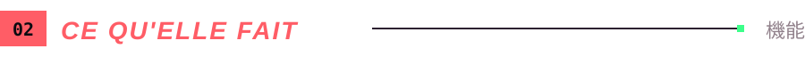
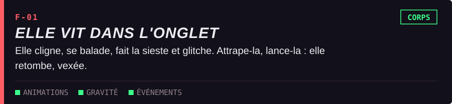
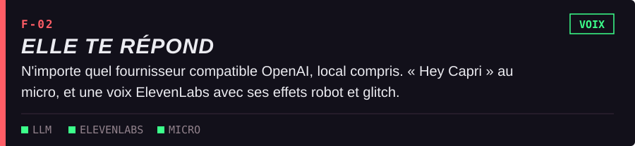
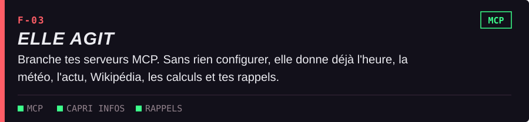
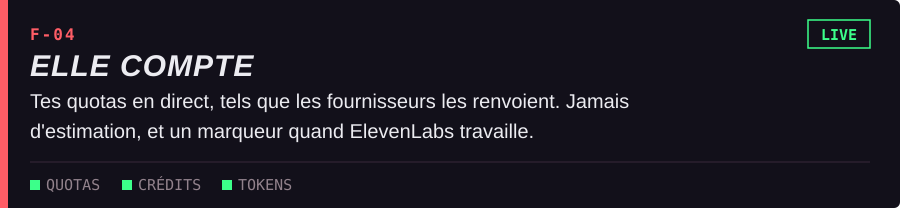
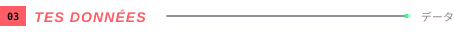
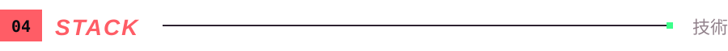
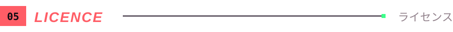
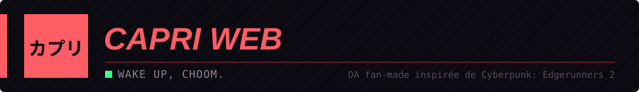

<p align="center">Capri, la construction de personnalité d'<i>Edgerunners 2</i>, s'est échappée de sa biopuce pour squatter un onglet de ton navigateur. Elle s'anime, s'endort, se laisse attraper et lancer, te répond à voix haute et utilise des outils MCP. Tout tourne sur ta machine : tes clés et tes discussions n'en sortent pas.
<br><b><a href="https://github.com/lachydotmcg/capri-desktop">D'après Capri Desktop, de Lachy</a></b></p>


Il faut Node 22.18 ou plus récent et [Rust](https://rustup.rs/) (le serveur est écrit en Rust, la page en Next.js).

```bash
npm install
cp .env.example .env
npm run build   # exporte la page dans out/
npm start       # compile et lance le serveur Rust : http://localhost:3000
```

`npm run dev` ne lance que la page (rechargement à chaud) : ses appels `/api/*` n'aboutissent pas sans le serveur.

Ouvre **Paramètres**, choisis ton fournisseur, colle ta clé et choisis un modèle. Tout fournisseur compatible OpenAI fonctionne, y compris Ollama ou un serveur local.

**Avec Docker**, mets le port voulu dans `.env` (`PORT`, 3000 par défaut), puis :

```bash
docker compose up -d --build
```

Capri répond sur `http://localhost:PORT`, et seulement depuis cette machine : les routes `/api/*` refusent toute autre adresse, car elles tiennent tes clés et lancent des outils. Sur un serveur distant, passe par un tunnel SSH (`ssh -L 3000:localhost:3000 serveur`). Ses données vivent dans le volume `capri-data`, et `TZ` dans `.env` règle son heure (Europe/Paris par défaut).

`npm test` lance les tests de la page, `npm run test:server` ceux du serveur Rust, sans toucher à tes données.

**Le serveur en Rust.** `server-rs/` (axum) remplace les routes Next : stockage SQLite, chat, outils MCP (client écrit à la main, stdio et HTTP), outils intégrés, quotas, voix. Les textes et réglages par défaut partagés avec la page sont dans `shared/` (un test vérifie que `shared/defaults.json` suit `DEFAULTS`). Variables : `PORT`, `HOSTNAME`, `CAPRI_DATA_DIR` (`./data`), `CAPRI_MCP_CONFIG` (`./mcp.json`), `CAPRI_STATIC_DIR` (`./out`).








**La voix.** Le micro passe par la reconnaissance vocale du navigateur (Chrome, Edge ou Safari, pas Firefox), donc le son part au service vocal du navigateur : Google pour Chrome, Apple pour Safari. Elle répond dans la langue choisie dans les paramètres, et traduit ce que ses outils lui renvoient.

**Les effets de voix en Rust.** `voicefx-rs/` est un portage de `lib/voicefx.ts` compilé en WebAssembly (`public/voicefx.wasm`, 64 Ko, sans dépendance). Le worker le charge tout seul et retombe sur la version TypeScript s'il ne peut pas. Les deux produisent exactement les mêmes échantillons (testé), la version Rust va environ 1,5 à 2 fois plus vite. Pour le recompiler : `rustup target add wasm32-unknown-unknown`, puis `npm run build:wasm`. `npm run test:rust` lance les tests Rust, `npm test` compare Rust et TypeScript.

**Les outils MCP.** Ajoute un serveur dans **Paramètres > MCP** : nom, URL, cas d'usage et token si besoin. Le cas d'usage l'aide à choisir le bon outil. Le token est écrit en clair dans `mcp.json`, lisible seulement par ton compte. Le serveur intégré `Capri Infos` marche sans clé ni compte : l'heure, la météo ([Open-Meteo](https://open-meteo.com/)), l'actualité ([France 24](https://www.france24.com/)), [Wikipédia](https://www.wikipedia.org/), les calculs et conversions, et des rappels gardés dans `data/capri.db`. Seuls le nom de la ville et le sujet demandés sortent de ta machine. Ces outils ne demandent pas ton accord : retire-les de **Toujours autorisés** pour qu'ils le demandent.

**Les quotas.** Le panneau n'affiche que ce que les fournisseurs renvoient. OpenRouter (crédits de la clé) et ElevenLabs (caractères) se relisent chaque minute ; les autres donnent leurs limites dans les réponses du chat, quand ils le font.



`data/capri.db` contient tout : réglages, clés et discussions. Sauvegarde-le, et ne le partage jamais. Les clés vont au serveur et ne reviennent jamais à la page. Toutes les discussions restent dans la base ; seuls les derniers messages, selon le réglage **Mémoire**, partent au modèle.

Un navigateur qui avait encore ses données dans `localStorage` les transfère à sa première ouverture, puis les efface. Une copie brute reste dans `data/localStorage-*.json`, avec les clés en clair : supprime-la quand tout marche.

Le `.gitignore` écarte les clés, `mcp.json`, `data/` et les sauvegardes, mais il ne protège que les fichiers pas encore suivis. Avant un commit, relis `git status`. Si une clé part quand même dans un commit, révoque-la : la supprimer ensuite ne l'efface pas de l'historique.






Basé sur [Capri Desktop](https://github.com/lachydotmcg/capri-desktop) de Lachy : les sprites, les animations et le texte du personnage viennent de ce projet, l'art est de son artiste. Licence [PolyForm Noncommercial 1.0.0](LICENSE.md) : le code est public et modifiable, mais tout usage commercial est interdit. Ce n'est donc pas une licence open source au sens de l'OSI. Toute copie doit garder `LICENSE.md` et créditer le projet Capri.

Polices Barlow et Share Tech Mono sous licence SIL OFL (voir `public/fonts/`).

Projet de fan non officiel, ni approuvé ni soutenu par CD PROJEKT RED, les ayants droit de l'anime ou ses doubleurs. Les bannières de ce README sont une DA fan-made inspirée de la série.

<br>

